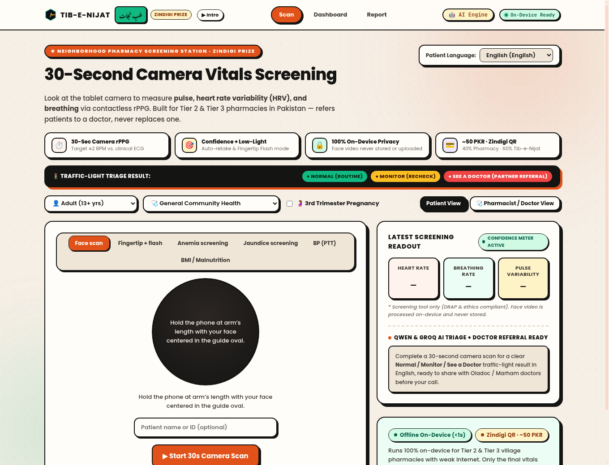
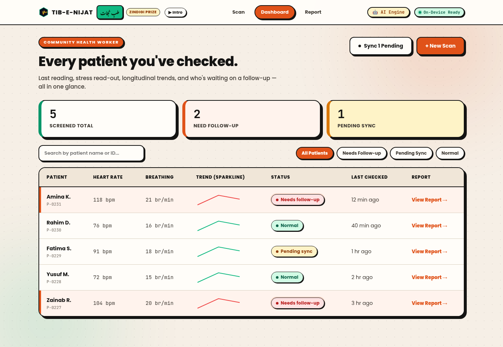
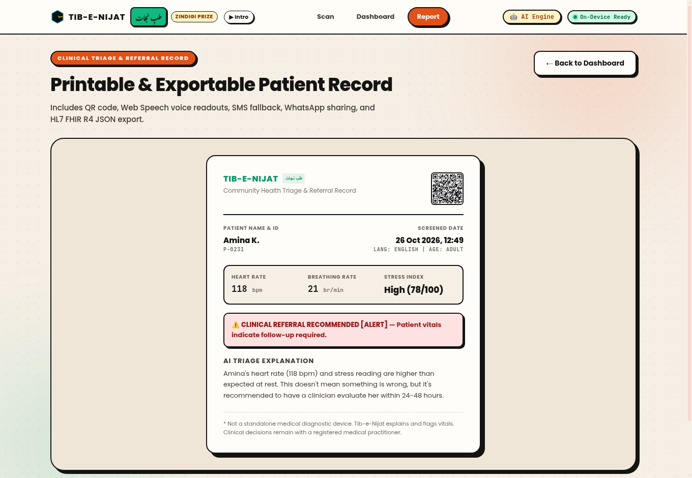

# Tib-e-Nijat (طبِ نجات) · Vytal AI
### 30-Second Camera-Based Vital Signs Screening & AI Clinical Triage for Neighborhood Pharmacies

> **Zindigi Prize & AI Healthcare Hackathon Submission**  
> **Team:** **Ahmad Ali** (Business & Partnerships) · **Sachin Kumar** (Technology & Demo) · **Muhammad Uzair** (Research & Validation)  
> **Canva Pitch Deck (Live Edit/View):** [https://www.canva.com/d/HLEedGjxNF8qZSo](https://www.canva.com/d/HLEedGjxNF8qZSo) (`DAHY9wIsTgM`)  
> **Pitch Script & Judge Q&A:** [PITCH_SCRIPT_AND_QNA.md](PITCH_SCRIPT_AND_QNA.md) · **PDF Deck:** [docs/Tib_e_Nijat_Zindigi_Prize_Pitch_Deck.pdf](docs/Tib_e_Nijat_Zindigi_Prize_Pitch_Deck.pdf)

---

## Live Canva Editorial Neo-Brutalist Clinical UI

| 30-Second Camera Vitals Screening | Community Pharmacy Dashboard | Printable Patient Record & QR |
| :---: | :---: | :---: |
|  |  |  |

---

## Executive Summary (The Pakistan Pharmacy Screening Model)

Pakistan has **fewer than 280,000 doctors for 240 million people**. In Tier 2 and Tier 3 cities, towns, and villages, a basic vitals check can require hours of travel and waiting in crowded hospital OPD queues—so millions of people skip preventive checks until they are seriously ill.

**Tib-e-Nijat (طبِ نجات)** (*formerly Vytal*) transforms an ordinary tablet or smartphone camera at a neighborhood pharmacy into a **30-second contactless vital signs screening station**:

1. **30-Second Camera rPPG Screening:** Measures **pulse (heart rate), heart rate variability (HRV), and breathing rate** from subtle skin micro-color shifts, plus a **Traffic-Light Triage Result** (`🟢 Normal`, `🟡 Monitor`, `🔴 See a Doctor`).
2. **Built for Pakistan's Real-World Conditions:**
   - **Signal Confidence Meter:** Automatically detects poor lighting or motion and prompts a retake rather than displaying a noisy reading.
   - **Fingertip + Flash Mode:** Uses rear camera + LED flash transillumination for low-light rooms.
   - **Clinical Accuracy Target:** Within **±2 BPM of an ECG**, to be validated in a 100–200 patient hospital ethics trial (Months 1–3).
3. **100% On-Device Privacy & DRAP Compliance:** Face video is processed locally in volatile RAM via WebAssembly/MediaPipe and **never stored or uploaded**. Only the numerical vitals summary is saved with patient consent. Positioned strictly as a **screening & referral tool** that sends patients to doctors (partnering with **Oladoc & Marham** so doctors see vitals before the call).
4. **Sustainable Pharmacy Unit Economics (~50 PKR / Zindigi QR):**
   - **~50 PKR per scan** paid in cash or via **Zindigi QR**.
   - **40% (~20 PKR)** goes to the neighborhood pharmacy owner; **60% (~30 PKR)** stays with Tib-e-Nijat for software, tablets, and support.
   - At ~20 scans/day, generates **~30,000 PKR/month per store** while driving walk-in footfall.

---

# Key Features

##  Dual-Mode Camera-Based Vital Screening

Vytal supports two independent scanning methods to maximize compatibility across different devices and environments.

###  Face Scan Mode

Uses **remote Photoplethysmography (rPPG)** to estimate vital signs by analyzing subtle skin color changes captured by the front camera.

Features include:

- MediaPipe Face Detection
- Dynamic Face Oval Guide
- Automatic face alignment
- Live scan quality monitoring
- CHROM Algorithm
- Goertzel Frequency Analysis
- Real-time pulse waveform visualization

Live guidance messages include:

- Face not detected
- Position face inside guide
- Perfect! Hold still for scan

---

###  Fingertip + Flash Mode

For environments with poor lighting or unsupported front cameras, users can place their fingertip over the rear camera and flashlight.

Features include:

- Dedicated finger placement overlay
- Red-channel light intensity analysis
- Contact quality detection
- Automatic scan readiness validation

Live guidance includes:

- Turn flash on
- Place fingertip over camera
- Press firmly
- Perfect! Hold still for scan

---

##  Clinical Research Features (29 Integrated Algorithms)

###  SpO2 Proxy Estimation
Uses the Ratio-of-Ratios ($RoR = (AC/DC)_{red} / (AC/DC)_{blue}$) rPPG method to estimate blood oxygen saturation with honest confidence disclaimers (`src/lib/spo2.js`).

###  AFib & Irregular Heartbeat Flagging
Analyzes inter-beat interval ($RR$) timing variance via RMSSD (>100ms) and pNN50 (>0.30) to flag potential irregular cardiac rhythms for clinical ECG confirmation (`src/lib/afib.js`).

###  3-Level Triage Alert Scale
Replaces binary flags with **GREEN** (Normal), **YELLOW** (Monitor), **ORANGE** (Same-Day Referral), and **RED** (Urgent Transfer) alert levels, powered by WHO IMCI and PALS clinical reference guidelines (`src/lib/alertScale.js`).

###  Anemia & Conjunctival Pallor Screening
Analyzes lower palpebral conjunctiva ROI in HSV color space to estimate hemoglobin (Hb g/dL) levels (`src/lib/anemia.js`).

###  Jaundice & Scleral Icterus Analysis
Segments the white of the eye (sclera) to measure yellowing and chromaticity shifts indicative of elevated bilirubin (`src/lib/jaundice.js`).

### 📱 Pediatric & Pregnancy Modes
Age-banded threshold swapping for adults, children, toddlers, and infants, with maternal baseline adjustments for 3rd trimester physiology (`src/lib/alertScale.js`).

###  Pulse Transit Time (PTT) Blood Pressure
Estimates Systolic and Diastolic BP trends based on pulse wave velocity delay (`src/lib/bloodPressurePTT.js`).

###  Anthropometric Malnutrition & BMI Screening
Computes body framing shoulder-to-height proportions to estimate BMI and screen for Severe Acute Malnutrition (SAM) (`src/lib/bmiEstimate.js`).

### 🌐 Interoperability & Platform Deployment
Generates HL7 FHIR R4 `Observation` JSON bundles, DHIS2 Tracker events, Web Speech API spoken readouts, and native SMS / WhatsApp sharing triggers (`src/lib/platform.js`).

### 📊 Longitudinal Risk & Population Anomaly Detection
Uses least-squares multi-visit trend regression and Shewhart SPC statistical anomaly triggers for regional outbreak surveillance (`src/lib/longitudinalRisk.js` & `src/lib/populationAnomaly.js`).

---

##  Live PPG Signal Visualization

During every scan, Vytal displays a live waveform representing the captured PPG signal.

This helps users immediately understand whether the signal quality is sufficient before measurements are completed.

---

#  AI Clinical Assistant

Vytal includes an AI-powered explanation layer that converts technical health metrics into language patients can easily understand.

Supported AI Providers:

- Alibaba Cloud DashScope (Qwen)
- Groq (LLaMA 3.3 70B)

Capabilities include:

- Plain-language patient explanations
- Technical Clinician View summaries with LOINC mapping & differential diagnosis hints
- Multi-tier AI coaching scripts
- Local language support
- Safe offline fallback rules

If no internet connection or API key is available, Vytal automatically switches to its built-in clinical rule engine without interrupting the workflow.

---

#  Multilingual Support

The application currently supports:

- 🇬🇧 English
- 🇵🇰 Urdu (اردو)
- 🇦🇫 Pashto (پښتو)
- 🇵🇰 Sindhi (سنڌي)
- 🇸🇦 Arabic (العربية)
- 🇰🇪 Swahili (Kiswahili)
- 🇮🇳 Hindi (हिन्दी)
- 🇧🇩 Bengali (বাংলা)

---

#  Offline-First Architecture

Healthcare workers frequently operate in locations with unreliable internet access.

For this reason, every completed scan is immediately stored locally.

Storage technologies include:

- IndexedDB
- LocalStorage

Features:

- Offline patient records
- Automatic queue creation
- Pending sync tracking
- Local-first workflow
- No data loss during network outages

---

# ☁ Alibaba Cloud Integration

When connectivity becomes available, queued records can be synchronized with Alibaba Cloud services.

Designed integrations include:

- Alibaba Cloud DashScope
- Function Compute
- Object Storage Service (OSS)
- Tablestore

This enables scalable cloud storage while preserving offline usability.

---

#  Community Health Worker Dashboard

The dashboard provides a centralized patient management interface.

Features include:

- Patient search
- Patient history with SVG sparkline trend graphs
- Triage alert filtering
- Offline queue monitoring
- Pending synchronization tracking

Available filters:

- 🟢 Normal
- 🔴 Needs Follow-up
- 🟡 Pending Sync

---

#  Printable Referral Report

Every completed scan can generate a professional one-page referral report.

The report includes:

- Patient information
- Scan summary & SpO2 proxy
- Estimated vital signs & Alert Tier
- AI clinical explanation
- Web Speech voice readout button
- HL7 FHIR R4 JSON export download
- SMS referral & WhatsApp sharing triggers
- QR Code linking to patient record
- Print-optimized layout

The page uses dedicated `@media print` styling for clean printing on both A4 paper and thermal printers.

---

#  Signal Processing Pipeline

The physiological signal pipeline consists of multiple stages:

```
Camera Frames
      │
      ▼
Face Detection / Finger Detection
      │
      ▼
ROI Extraction
      │
      ▼
RGB Signal Processing
      │
      ▼
CHROM Algorithm
      │
      ▼
Goertzel Frequency Analysis
      │
      ▼
Estimated Heart Rate & SpO2 Proxy
      │
      ▼
AI Clinical Interpretation & Alert Scale
      │
      ▼
Dashboard & Referral Report
```

---

#  Technology Stack

| Category | Technologies |
|-----------|--------------|
| Frontend | React 18, Vite |
| Styling | CSS3, Custom Clinical Design System |
| Camera APIs | HTML5 Camera, Canvas API |
| Face Detection | MediaPipe Tasks Vision |
| Signal Processing | CHROM Algorithm, Goertzel Algorithm |
| AI Models | Qwen (Alibaba DashScope), Groq LLaMA 3.3 70B |
| Hardware & Web APIs | Web Bluetooth (BLE), Web USB, Web Speech API |
| Interoperability | HL7 FHIR R4, DHIS2 Tracker Format |
| Storage | IndexedDB, LocalStorage |
| QR Generation | qrcode |
| Cloud | Alibaba Cloud Function Compute, OSS, Tablestore |

---

#  High-Level Architecture

```
                           VYTAL PLATFORM

             ┌──────────────────────────────────────────────┐
             │              User Camera Input               │
             └──────────────────────────────────────────────┘
                               │
                 ┌────────────┴────────────┐
                 │                         │
          Face Scan                 Finger + Flash
                 │                         │
                 └────────────┬────────────┘
                               │
                      rPPG Signal Extraction
                               │
                  CHROM + Goertzel Processing
                               │
                    Estimated Vital Signs & SpO2
                               │
                 ┌────────────┴────────────┐
                 │                         │
          AI Interpretation         Offline Storage
                 │                         │
                 └────────────┬────────────┘
                               │
                   Dashboard & Referral Report
```

---

#  Getting Started

## Prerequisites

- Node.js 18+
- npm
- Modern Browser
- Camera Permission

---

## Installation

Clone the repository:

```bash
git clone https://github.com/Ahmad-Ali-Shah/Vital.git
cd Vital
```

Install dependencies:

```bash
npm install --ignore-scripts
```

Run development server:

```bash
npm run dev
```

Open:

```
http://localhost:5173
```

---

## Production Build

```bash
npm run build
```

Preview production build:

```bash
npm run preview
```

---

#  Project Structure

```
vytal-app/
│
├── idea/
│   ├── Vytal_Research_Dossier/
│   │   ├── mds/ (01-spo2, 02-afib, 03-alert-scale ... 29-wearable)
│   │   └── Vytal_Research_Dossier.pdf
│   ├── Vytal_3Day_Roadmap.md
│   ├── Vytal_Explained.md
│   ├── Vytal_Research_Foundations.md
│   ├── Vytal_Seven_Day_Build_Plan.pdf
│   └── Vytal_Tech_Stack.md
│
├── public/
│   └── favicon.svg
│
├── src/
│   │
│   ├── components/
│   │   ├── AiConfigModal.jsx
│   │   ├── NavBar.jsx
│   │   ├── PulseMark.jsx
│   │   └── SplashAnimation.jsx
│   │
│   ├── lib/
│   │   ├── afib.js
│   │   ├── ai.js
│   │   ├── alertScale.js
│   │   ├── anemia.js
│   │   ├── bleOximeter.js
│   │   ├── bloodPressurePTT.js
│   │   ├── bmiEstimate.js
│   │   ├── jaundice.js
│   │   ├── longitudinalRisk.js
│   │   ├── platform.js
│   │   ├── populationAnomaly.js
│   │   ├── rppg.js
│   │   ├── spo2.js
│   │   ├── storage.js
│   │   ├── thermalCamera.js
│   │   ├── uncertainty.js
│   │   └── wearableIntegration.js
│   │
│   ├── pages/
│   │   ├── ScanPage.jsx
│   │   ├── DashboardPage.jsx
│   │   └── ReportPage.jsx
│   │
│   ├── App.jsx
│   ├── index.css
│   └── main.jsx
│
├── index.html
├── package.json
├── package-lock.json
├── vite.config.js
└── README.md
```

---

#  Documentation

The repository also contains detailed project documentation inside the **idea/** directory.

| File | Description |
|------|-------------|
| Vytal_Explained.md | Overall project vision and concept |
| Vytal_Research_Foundations.md | Scientific research and medical references behind rPPG |
| Vytal_3Day_Roadmap.md | Initial implementation roadmap |
| Vytal_Seven_Day_Build_Plan.pdf | Complete development schedule |
| Vytal_Tech_Stack.md | Technical architecture and technology decisions |
| Vytal_Research_Dossier/ | 21 research dossiers for clinical features |

These documents describe the planning, research, architecture, and implementation process followed during development.

---

#  Team

### Ahmad Ali Shah
**AI, Signal Processing & Backend Architect**

- rPPG Pipeline
- AI Integration
- Offline Architecture
- Clinical Logic
- Backend Design

---

### Muhammad Ahmad
**Frontend Engineer & Signal Integration**

- React Development
- UI Components
- Camera Experience
- Dashboard
- Visualization

---

### Laiba
**Cloud Architecture & Database Systems**

- Alibaba Cloud Services
- Database Design
- Storage Architecture
- Cloud Synchronization

---

#  Current Prototype Status

Implemented:

- ✅ Face rPPG Scanning
- ✅ Finger + Flash Scanning
- ✅ Live PPG Waveform
- ✅ SpO2 Proxy Estimation ($RoR$)
- ✅ AFib Irregular Rhythm Flagging
- ✅ 3-Level Triage Alert Scale (GREEN/YELLOW/ORANGE/RED)
- ✅ Anemia (Conjunctival Pallor) Screening
- ✅ Jaundice (Scleral Icterus) Screening
- ✅ Pediatric & Pregnancy Modes
- ✅ PTT Blood Pressure Estimation
- ✅ Malnutrition & BMI Screening
- ✅ HL7 FHIR R4 JSON Export
- ✅ Web Speech API Voice Readout
- ✅ Longitudinal Risk Trend Sparklines
- ✅ Shewhart SPC Population Outbreak Detection
- ✅ Web Bluetooth BLE & Web USB Thermal Integration
- ✅ AI Health Explanations & Dual Clinician View
- ✅ Multilingual Interface (8 Languages)
- ✅ Offline Queue & Storage
- ✅ Dashboard with Filters & Sparklines
- ✅ Printable Referral Reports with QR Codes

---

#  Disclaimer

Vytal is an AI-assisted healthcare screening prototype developed for the **Bano Qabil × Alibaba Cloud AI Hackathon 2026**.

The application is **not** a certified medical device and should **not** be used as a replacement for professional medical diagnosis or emergency care.

All measurements are intended for **screening, triage, and decision support only**. Final clinical decisions must always be made by qualified healthcare professionals.

---

# ❤️ Built For

Making accessible healthcare possible through AI, computer vision, and offline-first technology.
